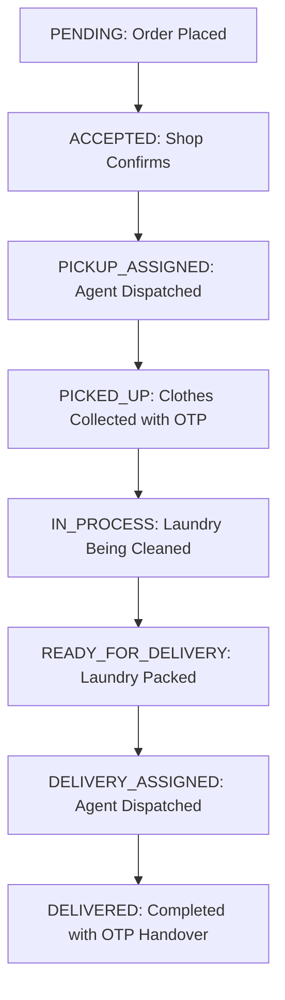

# FreshPress - Project Architecture & Working

FreshPress is a comprehensive, on-demand laundry and dry-cleaning service ecosystem. It features four dedicated mobile applications (Customer, Delivery Agent, Vendor/Partner, and Superadmin), a web showcase, and a high-performance central backend REST & WebSocket API that orchestrates all business logic, real-time tracking, data persistence, and third-party integrations.

---

## 1. System Architecture (Monorepo)

The repository is organized into modular services and applications:

| Directory | Type | Technologies | Description |
| :--- | :--- | :--- | :--- |
| [`freshpress-app`](file:///d:/project-cloth/freshpress-app) | Mobile (Customer) | React Native, Expo SDK 57, Expo Router, Zustand | Customer-facing app for discovering local shops, scheduling pickups, tracking orders, and managing wallets. |
| [`freshpress-agent-app`](file:///d:/project-cloth/freshpress-agent-app) | Mobile (Agent) | React Native, Expo SDK 57, Expo Router, Zustand | Delivery partner app for accepting pickup/delivery orders, route navigation, and OTP handover verification. |
| [`freshpress-vendor-app`](file:///d:/project-cloth/freshpress-vendor-app) | Mobile (Vendor) | React Native, Expo SDK 57, Expo Router, Zustand | Shop partner app to accept customer orders, manage processing stages, update item counts, and track payouts. |
| [`freshpress-admin-app`](file:///d:/project-cloth/freshpress-admin-app) | Mobile/Web (Admin) | React Native, Expo SDK 57, Expo Router, Zustand | Superadmin portal for platform oversight, service zone definitions, banner management, and disputes. |
| [`freshpress-backend`](file:///d:/project-cloth/freshpress-backend) | Backend API | Node.js, Express, TypeScript, Prisma ORM, PostgreSQL, Socket.io | Core server managing relational databases, spatial geo-queries, authentication, payments, and live WebSockets. |
| [`lovable`](file:///d:/project-cloth/lovable) | Web Storefront | React 18, Vite, Tailwind CSS | High-converting web landing and catalog showcase application. |
| [`newimages`](file:///d:/project-cloth/newimages) / [`img`](file:///d:/project-cloth/img) | Assets | High-Res PNG / JPG | Brand banners, promotional graphics, and category icons used across all apps. |

---

## 2. User Roles & Workflows

The platform supports four distinct user roles:

- **CUSTOMER**: Browses nearby laundry & dry-cleaning vendors by GPS radius, customizes item laundry preferences (wash & fold, iron, dry clean), applies promo coupons, pays online (Razorpay/Wallet/COD), and monitors live order progress.
- **AGENT**: On-demand delivery personnel who receive dispatch notifications, accept pickup/delivery assignments, navigate to customer/shop locations, and execute secure handovers via OTP.
- **VENDOR / SHOP_OWNER**: Laundry facility operators who verify incoming garment lists, adjust weights or item counts, update order status throughout laundering, and dispatch completed orders.
- **ADMIN**: Superusers with full privileges to configure commission rates, approve new shops, manage cities/zones, trigger system banners, and audit financial records.

---

## 3. Core Workflows & Features

### A. Shop & Service Discovery (Customer App)
- Uses the device's geolocation (`lat`/`lng`) to query the backend for active **Service Zones** and nearby **Shops**.
- The backend serves localized banners and a list of active vendors sorted by proximity and ratings.
- Vendors define **Service Categories** (Wash & Fold, Wash & Iron, Dry Cleaning, Shoe Cleaning) with flexible pricing units (Per Piece or Per KG).

### B. Order Placement (Cart & Checkout)
1. **Cart Management:** Customers add services/items specific to a chosen vendor.
2. **Scheduling:** Customers select convenient time slots for both **Pickup** and **Delivery**.
3. **Coupons & Wallet:** Customers can apply valid discount promo codes or debit their digital **Wallet** balance.
4. **Checkout & Payment:** Calculates line-item totals, applicable taxes, platform fees, and delivery charges. Supports **Razorpay** online payments, digital wallet debit, or Cash on Delivery (COD).

### C. Order Fulfillment Lifecycle
Orders transition deterministically through statuses defined in the backend Prisma schema (`OrderStatus` enum):



1. **PENDING**: Customer placed the order; awaiting vendor confirmation.
2. **ACCEPTED**: Vendor accepted the order into their queue.
3. **PICKUP_ASSIGNED**: An active delivery agent has accepted the pickup task.
4. **PICKED_UP**: Agent collected garments from customer (authenticated via customer-provided OTP).
5. **IN_PROCESS**: Vendor received garments and is actively laundering them.
6. **READY_FOR_DELIVERY**: Garments are cleaned, inspected, and packaged.
7. **DELIVERY_ASSIGNED**: Agent accepted the delivery run from vendor to customer.
8. **DELIVERED**: Successfully handed back to customer (verified via completion OTP).

### D. Automated Agent Dispatch & Location Tracking
- Geographically locates active agents within range of the pickup location.
- Generates `OrderAssignment` records with timed acceptance windows.
- Tracks agent coordinates via WebSocket connections (`Socket.io`) to render real-time vehicle movement on customer and vendor tracking maps.

### E. Digital Wallet & Subscription Plans
- **Wallet System:** In-app ledger where users can add funds via Razorpay, collect promotional cashback, or receive instantaneous refund credits.
- **Subscriptions:** Customers can purchase recurring monthly laundry plans (e.g., unlimited shirts, fixed-KG bundle plans) to bypass per-order fees.

### F. Push Notifications & Double-Sided Reviews
- **Notifications:** Dynamic in-app and push notifications for order milestone updates (order confirmed, driver arriving, laundry cleaned, order delivered).
- **Reviews:** Customers rate vendor quality and agent speed; vendors can rate customer compliance.

---

## 4. Backend Technical Details

- **Database:** PostgreSQL accessed via **Prisma ORM**, maintaining relations across Users, Shops, ServiceCategories, Orders, OrderItems, Payments, and Reviews.
- **Authentication:** Stateless **JWT** (JSON Web Tokens) with access and refresh tokens. Role-based middleware ensures route isolation (`CUSTOMER`, `AGENT`, `VENDOR`, `ADMIN`).
- **OTP Verification:** Firebase Admin & Twilio SMS integrations for phone number authentication and two-step physical handover security.
- **Real-Time Communication:** **Socket.io** server handling bi-directional location broadcasts, order status events, and chat/dispatch signals.
- **Spatial Geo-Queries:** PostGIS / raw SQL geospatial queries for bounding-box and radius filtering (`ST_DWithin`) to find nearby vendors and agents.

---

## 5. Third-Party Integrations

- **Razorpay**: Direct payment gateway integration for UPI, Credit/Debit cards, Net Banking, and instant refunds.
- **Firebase / Twilio / MSG91**: Multi-provider SMS gateway fallback for OTPs.
- **MapLibre / Google Maps**: Interactive vector map displays in React Native for address selection and driver navigation.

---

## 6. Local Development & Running Guide

### A. Prerequisites
- **Node.js** (v18 or higher recommended)
- **PostgreSQL** database running locally or via Docker
- **Expo Go** app or Android/iOS Emulator

### B. Starting the Backend API
```powershell
cd freshpress-backend
npm install
npx prisma migrate dev
npm run dev
# Server runs at http://localhost:3000 (API at /api)
```

### C. Running the Mobile Apps
Each mobile app uses Expo with Expo Router:

```powershell
# Customer App
cd freshpress-app
npm install
npx expo start

# Delivery Agent App
cd freshpress-agent-app
npm install
npx expo start

# Vendor Partner App
cd freshpress-vendor-app
npm install
npx expo start

# Admin App
cd freshpress-admin-app
npm install
npx expo start
```

### D. Environment Configuration
Each app connects to the backend through environment variables (e.g. [`.env.local`](file:///d:/project-cloth/freshpress-agent-app/.env.local)):
- `EXPO_PUBLIC_API_BASE_URL`: Base REST API endpoint (e.g. `http://<YOUR_IP>:3000/api`)
- `EXPO_PUBLIC_WS_URL`: WebSocket URL (e.g. `ws://<YOUR_IP>:3000`)

---

## 7. Version Control & GitHub

- **Official Repository:** [https://github.com/Pavan-5159/Freshpress.git](https://github.com/Pavan-5159/Freshpress.git)
- **Default Branch:** `main`

To push any updates:
```powershell
git add .
git commit -m "Your commit message"
git push
```
